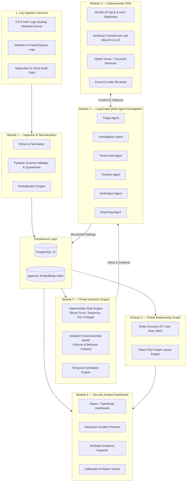
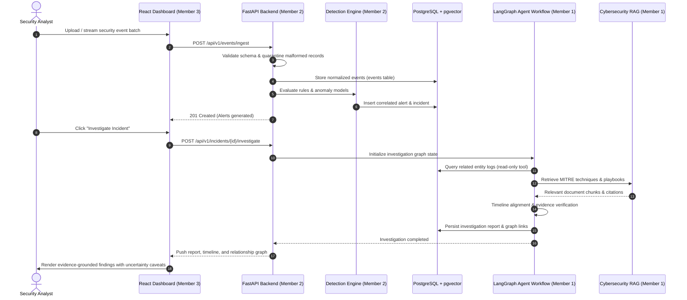
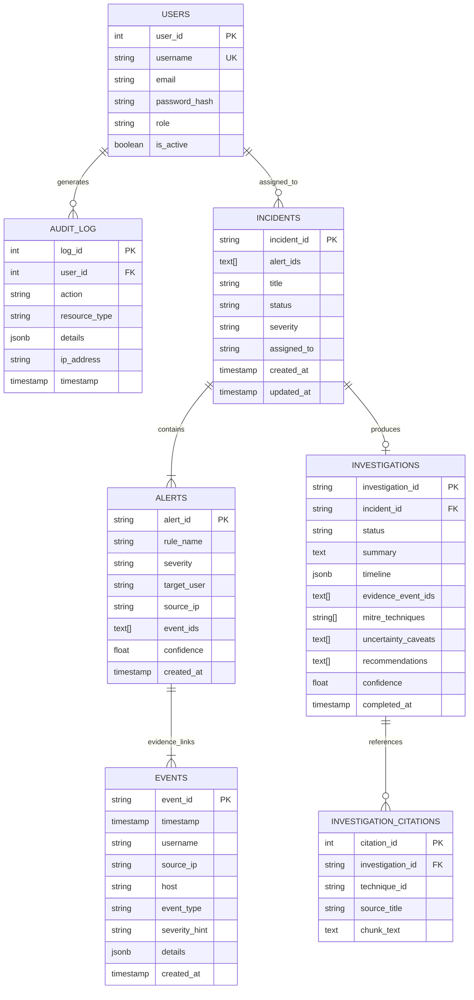

# CyberSleuth AI — System Architecture & Design Specification

CyberSleuth AI is an autonomous, evidence-grounded cybersecurity investigation platform. It automates security event triage, multi-event attack chain correlation, relevant knowledge retrieval via RAG, and LangGraph-coordinated AI investigation.

---

## 1. High-Level Architecture Overview

The platform is structured into six decoupled modules communicating via typed API interfaces and a relational database backing.

---

## 2. End-to-End Investigation Sequence

---

## 3. Module Breakdown

### Module 1 — Security Log Ingestion Pipeline
- **Purpose**: Ingests, normalizes, and validates heterogeneous security records.
- **Key Responsibilities**:
  - Parse structured formats (JSON, CSV, Syslog).
  - Normalize timestamp formats to ISO 8601 UTC.
  - Standardize schema: `event_id`, `timestamp`, `username`, `source_ip`, `host`, `event_type`, `severity_hint`, `details`.
  - Quarantine invalid records without breaking batch processing.
  - Deduplicate re-transmitted records.

### Module 2 — Threat Detection Engine
- **Purpose**: Identify suspicious activity using both deterministic signatures and statistical anomalies.
- **Rule Engine**:
  - Repeated failed logins (threshold $\ge 5$ within 5 minutes $\rightarrow$ T1110).
  - Failed logins followed by success from identical source IP $\rightarrow$ T1110.001.
  - Unauthorized privilege changes (approved=False or missing change ticket $\rightarrow$ T1548).
  - Outbound connection bursts and heavy data egress $\rightarrow$ T1041.
  - Temporal multi-stage attack correlation linking authentication, elevation, and egress.
- **Machine Learning Engine**:
  - Scikit-learn `IsolationForest` for detecting volume and out-of-schedule behavior outliers.

### Module 3 — Cybersecurity RAG (Retrieval-Augmented Generation)
- **Purpose**: Retrieve authoritative defensive knowledge from MITRE ATT&CK Enterprise Matrix and NIST SP 800-61 playbooks.
- **Architecture**:
  - Document chunking with semantic boundaries.
  - Dense embeddings via `sentence-transformers/all-MiniLM-L6-v2`.
  - Vector similarity search in PostgreSQL via `pgvector`.
  - Re-ranking using a cross-encoder to select top relevant context chunks.
  - Source attribution with verifiable citation links.

### Module 4 — Multi-Agent Investigation (LangGraph)
- **Purpose**: Coordinate autonomous, specialized AI agents in a controlled, non-hallucinatory DAG.
- **Specialized Roles**:
  - **Triage Agent**: Assesses initial severity and scopes the investigation boundary.
  - **Investigation Agent**: Calls safe, read-only tools to search logs for related IP and host activity.
  - **Threat Intelligence Agent**: Queries RAG for matching MITRE techniques and response playbooks.
  - **Timeline Agent**: Chronologically sorts and aligns all contributing evidence events.
  - **Verification Agent**: Validates that all draft assertions are backed by concrete event IDs; strikes out unverified assumptions.
  - **Reporting Agent**: Compiles the final structured incident report with explicit uncertainty caveats.

### Module 5 — Threat Relationship Graph
- **Purpose**: Connect disparate entities (Users, Workstations, IPs, Alerts, MITRE Techniques) into an interactive topological graph.
- **Technology**: React Flow with hierarchical force-directed node layout.
- **Design Principle**: Clearly distinguishes observed facts (solid links to event IDs) from inferred attack hypotheses (dashed links).

### Module 6 — Security Analyst Dashboard
- **Purpose**: Professional Web UI for Security Operations Center (SOC) analysts.
- **Features**:
  - Incident queue with priority filters.
  - Chronological event timeline.
  - Interactive React Flow entity relationship viewer.
  - Evidence viewer linking findings directly to raw event JSON.
  - Markdown investigation report display with citation references.

---

## 4. Relational Database Schema

---

## 5. Security & Isolation Controls

1. **Agent Tool Sandboxing**: AI agents are provided exclusively read-only tools (`search_logs`, `query_mitre_rag`, `get_timeline`). No write, alter, or delete database capabilities exist within the agent runtime.
2. **Untrusted Data Isolation**: All log fields (such as messages or file paths) are treated as passive string data and encapsulated inside strictly delimited data blocks, neutralising direct and indirect prompt injection attempts.
3. **Role-Based Access Control (RBAC)**: Backend endpoints verify JWT bearer tokens; analyst operations are recorded in the tamper-evident `audit_log` table.
4. **Input Sanitization**: Pydantic schemas enforce type safety and reject SQL injection, XSS, and path traversal sequences.
