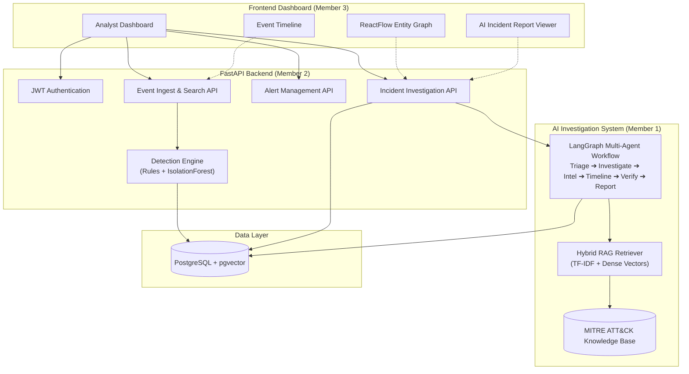

# 🛡️ CyberSleuth AI — Autonomous Security Investigation Platform

CyberSleuth AI is an autonomous, AI-powered cybersecurity investigation platform designed for Security Operations Center (SOC) teams. Rather than operating as a simple query-response chatbot, it ingests multi-source security telemetry, flags suspicious behavior through deterministic rules and machine learning, correlates disparate events across entities (users, hosts, IP addresses), retrieves grounded MITRE ATT&CK guidance, coordinates multi-agent investigation workflows via LangGraph, and renders an interactive security analyst dashboard.

---

## 👥 4-Member Project Division & Deliverables

| Member | Role | Core Responsibility | Key Deliverables |
|---|---|---|---|
| **Member 1** | **AI/ML & Agent Architecture Lead** | Autonomous investigation graph, RAG pipeline, LLM grounding | • LangGraph investigation state graph (`triage` → `investigate` → `threat_intel` → `timeline` → `verification` → `report`)<br>• Hybrid RAG retriever (TF-IDF + dense cosine similarity)<br>• MITRE ATT&CK knowledge base with citations<br>• Evidence verification engine preventing ungrounded hallucinations |
| **Member 2** | **Backend, Detection & Data Engineering** | Core API, relational schema, deterministic detection, ML anomaly model | • FastAPI application with async endpoints and JWT authentication<br>• SQLAlchemy ORM schema for events, alerts, incidents, users<br>• Deterministic detection rules (BruteForce, PrivilegeChange, LateralMovement, UnusualOutbound)<br>• IsolationForest anomaly scoring pipeline<br>• Zero-trust, read-only search tools for AI agents |
| **Member 3** | **Frontend & Security Visualization** | Modern analyst interface, graph visualization, timeline, reporting UI | • React 18 + TypeScript + Vite web dashboard<br>• Ant Design dark-themed SOC interface<br>• Interactive Entity Relationship Graph using ReactFlow<br>• Chronological event timeline with severity indicators<br>• Evidence viewer and AI investigation report with MITRE technique badges |
| **Member 4** | **Security Scenarios, QA & Evaluation** | Test suite, synthetic datasets, RAG evaluation, safety testing | • Comprehensive synthetic security telemetry datasets (benign, suspicious, edge cases, adversarial)<br>• 106 automated tests covering detection, API security, and agent safety<br>• Quantitative RAG evaluation framework (Recall@K, MRR, nDCG@K, Faithfulness)<br>• Security prompt injection and malicious payload resistance test suite |

---

## 🏗️ System Architecture



---

## 🚀 Quick Start Guide

### Option A: One-Command Docker Setup (Recommended)

1. Clone or open the repository root:
   ```bash
   cd CyberSleuth
   ```

2. Start all services (Database, FastAPI Backend, React Frontend):
   ```bash
   docker compose up --build
   ```

3. Open your browser:
   - **Frontend Dashboard:** [http://localhost:5173](http://localhost:5173)
   - **Backend OpenAPI Docs:** [http://localhost:8000/docs](http://localhost:8000/docs)
   - **Default Credentials:** Username: `admin` | Password: `admin123`

---

### Option B: Local Development Setup

#### 1. Backend Setup
```bash
cd backend
python -m venv venv
# Windows:
.\venv\Scripts\activate
# Linux/macOS:
source venv/bin/activate

pip install -r requirements.txt

# Run initial database seeding and demo scenario:
python -m app.scripts.seed_db

# Start backend server:
uvicorn app.main:app --host 0.0.0.0 --port 8000 --reload
```

#### 2. Frontend Setup
```bash
cd ../frontend
npm install
npm run dev
```

Open [http://localhost:5173](http://localhost:5173) in your browser.

---

## 🧪 Testing & Verification

### Run Backend Unit Tests:
```bash
cd backend
python -m pytest app/tests -v
```

### Run Member 4 Comprehensive Test Suite (106 tests):
```bash
cd CyberSleuth_Synthetic_Dataset
pytest tests -v
```

### Run RAG and ML Evaluation:
```bash
cd CyberSleuth_Synthetic_Dataset
python -m evaluation.run_evaluation --mode full
```

---

## 📁 Repository Directory Structure

```
CyberSleuth/
├── backend/                         # Member 2 & Member 1
│   ├── app/
│   │   ├── api/                     # FastAPI endpoints (auth, events, alerts, incidents)
│   │   ├── core/                    # Config, DB connection, JWT security
│   │   ├── detection/               # Detection rules & IsolationForest model
│   │   ├── models/                  # SQLAlchemy ORM models
│   │   ├── rag/                     # MITRE KB, Hybrid Retriever, LangGraph Agents
│   │   ├── schemas/                 # Pydantic request/response validation
│   │   ├── scripts/                 # Seeding & dataset ingestion scripts
│   │   └── tests/                   # Backend API and Agent unit tests
│   ├── Dockerfile
│   └── requirements.txt
├── frontend/                        # Member 3
│   ├── src/
│   │   ├── components/              # AppLayout, AlertCard, EventTimeline, ThreatGraph, ReportViewer
│   │   ├── pages/                   # Login, Dashboard, IncidentList, IncidentDetail
│   │   ├── services/                # Axios API client & JWT interceptors
│   │   ├── hooks/                   # useAuth authentication hook
│   │   └── types/                   # TypeScript interfaces
│   ├── Dockerfile
│   ├── package.json
│   └── vite.config.ts
├── CyberSleuth_Synthetic_Dataset/   # Member 4
│   ├── datasets/                    # Benign, suspicious, edge-case, and MITRE scenarios
│   ├── evaluation/                  # Quantitative metrics and RAG golden evaluation
│   ├── tests/                       # 106 automated pytest test cases
│   └── docs/                        # Architecture, installation, and demo guides
└── docker-compose.yml               # Multi-container orchestration (Postgres, Backend, Frontend)
```

---

## 🛡️ Key Security Design Highlights
1. **Evidence-Grounded AI**: The verification agent cross-checks every alert against original log telemetry before including it in the final report, explicitly marking hypotheses as `[UNCERTAIN]` when evidence is incomplete.
2. **Read-Only Tool Sandboxing**: Agents interact with logs exclusively through restricted, read-only search interfaces (`/api/v1/events/search`), preventing unauthorized writes or arbitrary code execution.
3. **Adversarial Resilience**: Tested against prompt injection attempts disguised in usernames, hostnames, and details JSON fields.
